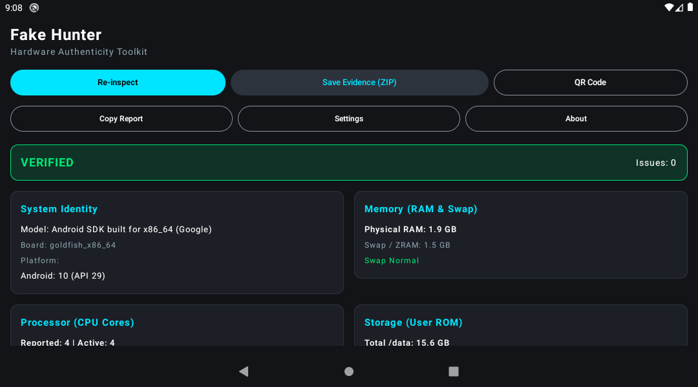
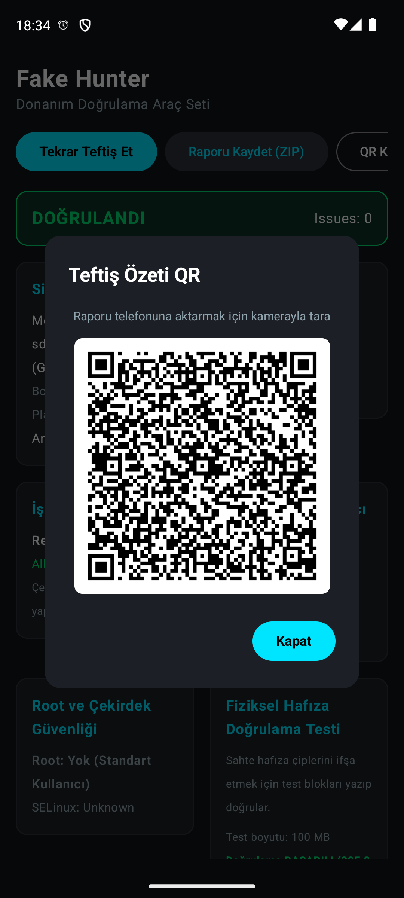
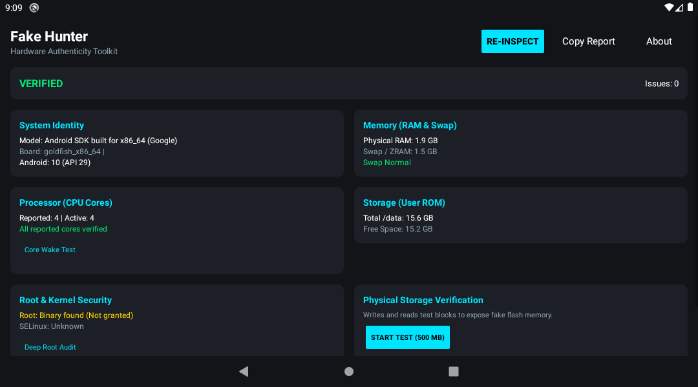
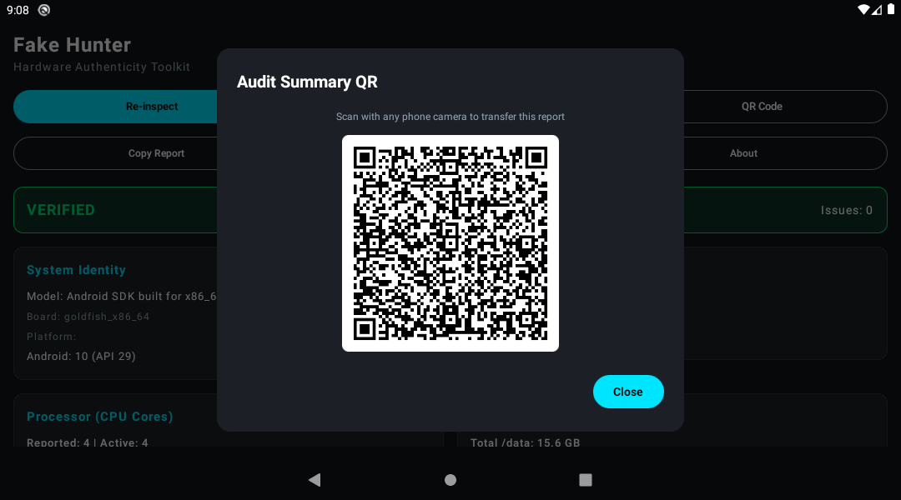
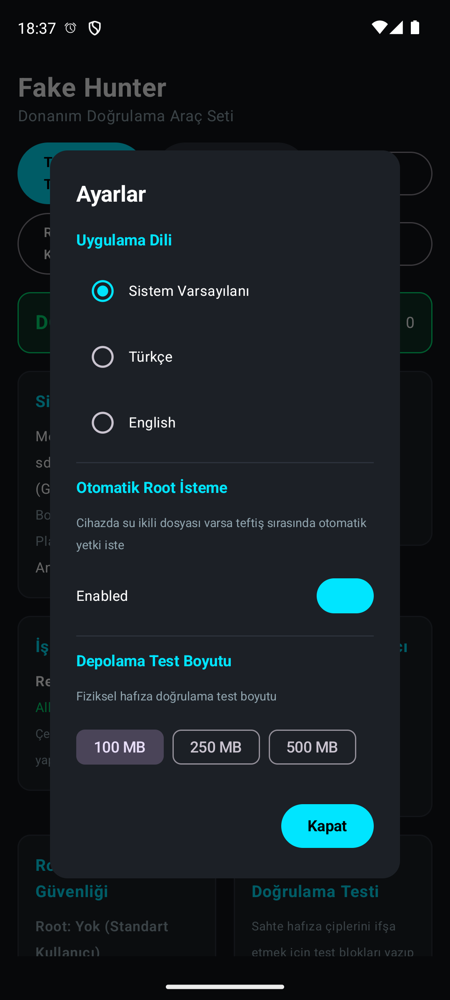

# Fake Hunter 🛡️

### Android Multimedya, Teyp ve TV Kutuları İçin Donanım Doğrulama ve Sahtecilik Tespit Kiti
### Hardware Authenticity & Fraud Detection Toolkit for Android Head Units & TV Boxes

[](LICENSE)
[-green.svg)](https://developer.android.com)
[](#-gizlilik-ve-g%C3%BCvenlik--privacy--security)
[](https://github.com/gokcank/Fake-Hunter/releases/tag/v1.1.0)
[](RELEASE_NOTES.md)

---

## 📸 Ekran Görüntüleri / Showcase

| 🚗 Araç Multimedya Teftişi (1024x600 Geniş Ekran) | 📱 Telefona Anında QR Transferi |
| :---: | :---: |
|  |  |

<details>
<summary>🔍 Diğer Arayüzler & Ekranlar / Additional Views (Classic XML, Settings, Widescreen QR)</summary>
<br>

| Klasik Arayüz (XML Views) | Geniş Ekran QR Özeti | Ayarlar & Dil Seçimi |
| :---: | :---: | :---: |
|  |  |  |

</details>

---

## 🎯 3 Maddede Fake Hunter Nedir? / What is Fake Hunter?

* 🚗 **Oto Teyp & Multimedya Alışverişinde Hile Kalkanı:** Piyasada "8 Çekirdek, 8 GB RAM, 128 GB Hafıza, Android 14" etiketiyle satılan ancak gerçekte 4 çekirdekli eski bir yongaya (AC8227L, Allwinner T3 vb.) ve Android 8.1 ROM'una sahip cihazları saniyeler içinde ifşa eder.
* 💾 **Sahte Depolama (NAND Flash) ve RAM Şişirmesi Tespiti:** ROM dosyalarını yanıltan sahte bilgileri es geçer; çekirdek dökümlerini (`/proc/meminfo`), raw sektör boyutunu (`/sys/block/*/size`) inceler ve 100 MB rastgele veri yazıp doğrulayarak sahte hafızayı bozulma (corruption) ile yakalar.
* 🛡️ **%100 Çevrimdışı & Adli Kanıt Kaydı:** Sıfır internet izni ister. Elde ettiği donanım kanıtlarını USB belleğe adli `.zip` arşivi olarak kaydeder veya tek dokunuşla ekranda QR koda dökerek telefonunuzun kamerasıyla yanınıza almanızı sağlar.

---

## ⚡ Hızlı Karar Rehberi / Quick Verdict Table

Mağazada veya araçta teybe Fake Hunter taktığınızda çıkan ekrana göre 5 saniyede karar verin:

| Bildirilen Özellik | Fiziksel RAM (`MemTotal`) | Takas / ZRAM (`SwapTotal`) | Çekirdek Frekansı | Karar / Verdict |
| :--- | :--- | :--- | :--- | :--- |
| **İddia: 8 GB RAM** | **7200 MB ve üzeri** | 0 - 2000 MB | 8 çekirdek aktif frekansta | ✅ **GERÇEK 8 GB** (Orijinal, alınabilir) |
| **İddia: 6 GB RAM** | **5400 - 6200 MB** | 0 - 2000 MB | 8 çekirdek aktif frekansta | ✅ **GERÇEK 6 GB** (Orijinal) |
| **İddia: 6 veya 8 GB** | **3800 - 4200 MB** | **3000 MB ve üzeri** | Yalnızca 4 çekirdek frekans üretiyor | ❌ **SAHTE DONANIM** (Aslında 4 GB RAM + SWAP şişirmesi) |
| **İddia: 4 veya 8 GB** | **1800 - 2400 MB** | **2000 MB ve üzeri** | 4 çekirdek | ❌ **SAHTE DONANIM** (Aslında 2 GB RAM) |
| **İddia: 64/128 GB ROM** | - | - | Depolama Testi: **Bozulma (Corruption)** | ❌ **SAHTE HAFIZA** (Yazılımla şişirilmiş 16 GB NAND) |

---

## 🇹🇷 Türkçe Açıklama

### Problem: Pazardaki Sahte Donanım Tuzağı
Özellikle Çin menşeili Android teypler, araç multimedya ekranları ve TV kutuları, sistem ayarları ve popüler test uygulamalarını kandırmak üzere modifiye edilmiş yazılımlarla gelir:
1. **Sahte 8 Çekirdek:** 4 çekirdekli yongaların sistem dosyaları 8 çekirdek gösterecek şekilde yamalanır; sahte çekirdekler frekans üretmez veya boştadır.
2. **SWAP ile Şişirilmiş RAM:** 2 GB veya 4 GB fiziksel bellek, takas alanı (SWAP/ZRAM) eklenerek toplam sanal değer üzerinden "6 GB" veya "8 GB" olarak etiketlenir.
3. **Sahte Depolama Kapasitesi:** 16 GB veya 32 GB kapasiteli ucuz flash yongalar, partition tabloları manipüle edilerek sistemde 64 GB veya 128 GB gösterilir; veri yazıldığında eski verilerin üzerine yazar veya çöker.
4. **Sahte Android Sürümü:** Sistem ayarlarında "Android 13" veya "Android 14" yazsa da çekirdekte eski Android 8.1 (Oreo) veya Android 10 (Q) çalışır.

### Fake Hunter Nasıl Çalışır?
* **Çekirdek Düzeyinde Bellek Okuma:** Android API'lerinin yanıltıcı çağrılarını atlar; doğrudan Linux çekirdeğinin `/proc/meminfo` dökümünden gerçek fiziksel RAM (`MemTotal`) ile takas alanını (`SwapTotal`) ayrıştırır.
* **Canlı Çekirdek Uyandırma Testi:** Çekirdeklere anlık hesaplama yükü bindirir ve `/sys/devices/system/cpu/cpu*/cpufreq/` düğümlerinden gerçek frekans üretip üretmediklerini doğrular.
* **Fiziksel Flash Sektör Taraması:** `/sys/block/*/size` üzerinden blok aygıtlarının raw sektör sayısını (512 bayt) okuyarak depolama silikonunun gerçek donanım sınırını belirler.
* **Fiziksel Yazma ve Bütünlük Doğrulaması:** Disk üzerine 100 MB'lık rastgele veri blokları yazar, ardından geri okuyarak sağlama toplamını doğrular. Sahte flash çipler bu aşamada doğrudan bozulma hatası verir.
* **Adli Teftiş ZIP Paketi (SAF):** Tek tıkla 11 teşhis dosyasını (`getprop`, `cpuinfo`, `meminfo`, `partitions`, `mounts`, `logcat`, `dmesg`, vb.) bir araya getirerek USB belleğe `.zip` olarak dışa aktarır.
* **Çevrimdışı QR Kod Özeti:** USB veya kablo bulunmayan durumlarda rapor özetini ekranda QR koda dökerek telefon kamerasıyla alınmasını sağlar.

---

## 🇬🇧 English Description

### The Problem: Systematic Hardware Fraud
Budget Android head units, car multimedia replacements, and TV streaming boxes from online marketplaces frequently employ deceptive firmware modifications:
1. **Spoofed Octa-Core:** Entry-level quad-core chips report 8 cores in system files; the phantom cores generate 0 Hz clock frequency.
2. **RAM Inflation via Swap:** Physical 2GB or 4GB RAM is artificially combined with Swap/ZRAM allocation to market the device as "6GB" or "8GB RAM".
3. **Spoofed Flash Capacity:** Low-cost 16GB/32GB NAND flash chips are modified at partition boundaries to report 64GB or 128GB, silently corrupting data once real capacity is exceeded.
4. **Android Version Spoofing:** Marketing labels and UI strings display "Android 13/14", while underlying kernel API level is actually Android 8.1 (API 27) or Android 10 (API 29).

### How Fake Hunter Detects Counterfeits
* **Direct Kernel Memory Parsing:** Bypasses framework-level queries to parse `/proc/meminfo` directly, isolating physical RAM (`MemTotal`) from Swap (`SwapTotal`).
* **Active CPU Core Benchmarking:** Applies a micro-workload across all reported cores and inspects `/sys/devices/system/cpu/` nodes to confirm genuine active clock frequencies.
* **Hardware Sector Capacity Detection:** Inspects `/sys/block/*/size` sector counts (512-byte sectors) to determine true physical eMMC/UFS silicon capacity before partition inflation.
* **Physical Flash Integrity Testing:** Performs sustained write/read cycles with randomized blocks, verifies integrity via checksums, and exposes fake NAND memory through readback corruption.
* **Forensic ZIP Evidence Export (SAF):** One-click packaging of 11 low-level diagnostic dumps into a standardized forensic archive.
* **On-Screen Offline QR Code:** Generates offline ZXing QR codes of the inspection verdict for instant smartphone camera scanning.

---

## 🚀 Kullanım Rehberi (Türkçe)

### Yöntem 1: Android Uygulaması ile Teftiş (Tavsiye Edilen - Bilgisayar Gerektirmez)
[GitHub Releases](https://github.com/gokcank/Fake-Hunter/releases) sayfasından en güncel APK'yı indirin veya bir USB belleğe kopyalayarak cihaza takın:
* **Modern Varyant (`FakeHunter-v1.1.0-Modern.apk`):** Jetpack Compose ile geliştirilmiş modern arayüz. 1024x600 ve üzeri güncel teypler, tabletler ve telefonlar için önerilir.
* **Klasik Varyant (`FakeHunter-v1.1.0-Classic.apk`):** Eski Android sürümleri (Android 5+) ve zayıf donanımlı teypler (Mali-400 GPU, 1-2 GB RAM) için optimize edilmiş hafif XML Views arayüzü.

**Teftiş Süreci ve Özellikler:**
1. **Otomatik Hepsi-Bir-Arada Teftiş:** Uygulama açıldığı anda veya *Tekrar Teftiş Et* butonuna basıldığında RAM, SWAP şişirmesi, CPU çekirdek uyandırma testi, `/sys/block/*/size` fiziksel flash çip boyutu ve 100 MB veri yazma/okuma testini otomatik yürütür.
2. **Adli Teftiş ZIP Arşivi (SAF):** *Raporu Kaydet (ZIP)* butonuna dokunarak mevcut teftiş raporunu ve 11 ayrı sistem dökümünü (`getprop`, `cpuinfo`, `meminfo`, `partitions`, `mounts`, `logcat`, `dmesg`, vb.) doğrudan USB belleğe `.zip` arşivi olarak kaydedebilirsiniz.
3. **Ekranda Çevrimdışı QR Kod:** *QR Kod* butonuna basarak teftiş özetini ekranda QR koda dökebilir, telefonunuzun kamerasıyla saniyeler içinde tarayarak yanınıza alabilirsiniz.
4. **Ayarlar:** Uygulama dilini (Türkçe / English / Sistem Varsayılanı), otomatik root yetkisi isteme tercihini ve depolama test blok boyutunu (100 MB, 250 MB, 500 MB) ayarlayabilirsiniz.

### Yöntem 2: Bilgisayardan ADB ile Teftiş (Host Script)
Cihazı USB kablosuyla veya Wi-Fi ADB üzerinden bilgisayarınıza bağlayın:

```bash
# Otomatik cihaz tespiti ve varsayılan teftiş
./scripts/fake_hunter_adb.sh

# Belirli bir cihazı hedefleyerek Türkçe dilde ve çekirdek uyandırmayla çalıştırma
./scripts/fake_hunter_adb.sh -s <cihaz_seri_no> --lang tr --wake --storage-test 100

# Raporları metin ve JSON olarak bilgisayara kaydetme
./scripts/fake_hunter_adb.sh --save teftis_raporu.txt --json teftis_raporu.json
```

### Yöntem 3: Cihaz Üzerinde Terminal Betiği (Kurulumsuz)
Cihazda Termux veya Terminal Emulator yüklüyse `scripts/fake_hunter.sh` dosyasını USB bellekten veya dahili hafızadan doğrudan çalıştırabilirsiniz:

```sh
# Doğrudan çalıştırma (Türkçe dilde)
sh fake_hunter.sh --lang tr

# Tam teşekküllü teftiş (çekirdek uyandırma + root sorgusu + 100 MB depolama testi)
sh fake_hunter.sh --lang tr --wake --root --storage-test 100 --output rapor.txt --json rapor.json
```

---

## 🚀 Usage Guide (English)

### Option 1: Android Application (Recommended - No PC Required)
Download the latest release APK from [GitHub Releases](https://github.com/gokcank/Fake-Hunter/releases) or transfer it via a USB flash drive:
* **Modern Flavor (`FakeHunter-v1.1.0-Modern.apk`):** Built with Jetpack Compose. Responsive, modern UI designed for multimedia screens, tablets, and phones.
* **Classic Flavor (`FakeHunter-v1.1.0-Classic.apk`):** Ultra lightweight XML Views implementation optimized for entry-level automotive head units (Mali-400 GPU, 1-2 GB RAM, Android 5.0+).

**Audit Workflow & Features:**
1. **All-in-One Automated Audit:** On startup or by clicking *Re-inspect*, the app automatically runs physical RAM analysis, Swap inflation detection, CPU core wake-up benchmarking, raw flash sector capacity detection, and 100 MB physical storage verification.
2. **Forensic Evidence ZIP Export (SAF):** Click *Save Evidence (ZIP)* to package on-screen audit results together with 11 low-level diagnostic dumps into a forensic `.zip` archive via Android's Storage Access Framework file picker.
3. **On-Screen QR Code:** Click *QR Code* to render an offline ZXing QR code containing the full audit summary, ready for instant camera capture with your phone.
4. **Settings Dialog:** Toggle language dynamically (Türkçe / English / System Default), enable/disable automatic root escalation, and customize the physical storage test block size (100 MB, 250 MB, 500 MB).

### Option 2: ADB Runner from Host PC
Connect your Android target via USB debugging or Wireless ADB:

```bash
# Auto-detect connected device and run default audit
./scripts/fake_hunter_adb.sh

# Target specific device with English language, CPU wake test, and 100MB storage test
./scripts/fake_hunter_adb.sh -s <device_serial> --lang en --wake --storage-test 100

# Export plain-text and JSON reports directly to host machine
./scripts/fake_hunter_adb.sh --save audit_report.txt --json audit_report.json
```

### Option 3: Standalone On-Device Shell Script
Run `scripts/fake_hunter.sh` directly on device without installing any APK:

```sh
# Basic run
sh fake_hunter.sh --lang en

# Comprehensive audit with CPU wake, root check, and physical storage test
sh fake_hunter.sh --lang en --wake --root --storage-test 100 --output report.txt --json report.json
```

---

## 🛡️ Gizlilik ve Güvenlik / Privacy & Security

* **Sıfır İnternet İzni Politikası:** `AndroidManifest.xml` içinde `android.permission.INTERNET` izni bulunmaz. Uygulama hiçbir sunucuyla iletişim kurmaz, telemetri veya analitik toplamaz.
* **Defansif Çekirdek İletişimi:** Tüm donanım okumaları `safeRun` korumalı bloklarıyla sarılmıştır. Kırpılmış, eksik veya alışılmadık otomotiv ROM'larında çökme yapmaz.
* **Açık Kaynak & Şeffaf:** Kodların tamamı açık kaynaktır; teftiş edilen kanıtlar kullanıcı kontrolünde sadece yerel cihaza veya USB'ye kaydedilir.

---

## 📋 Sürüm Geçmişi / Changelog

Tüm sürümlere ait detaylı değişiklikler ve teknik notlar için:
👉 **[RELEASE_NOTES.md](RELEASE_NOTES.md)**

---

## 📄 Lisans / License

Bu proje [MIT Lisansı](LICENSE) kapsamında açık kaynak olarak sunulmaktadır.
